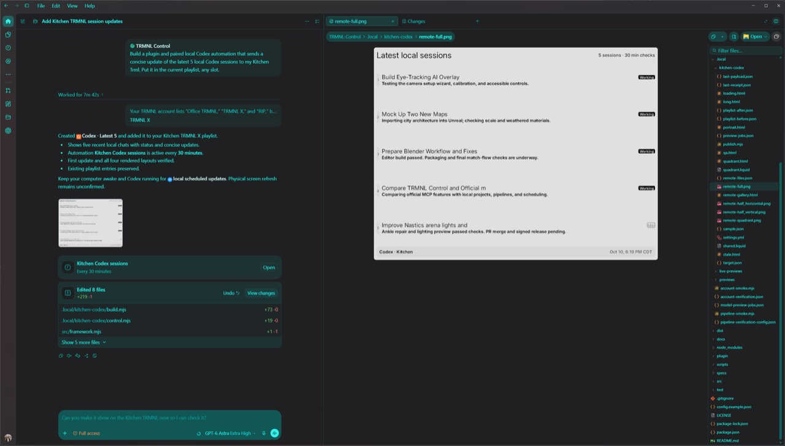
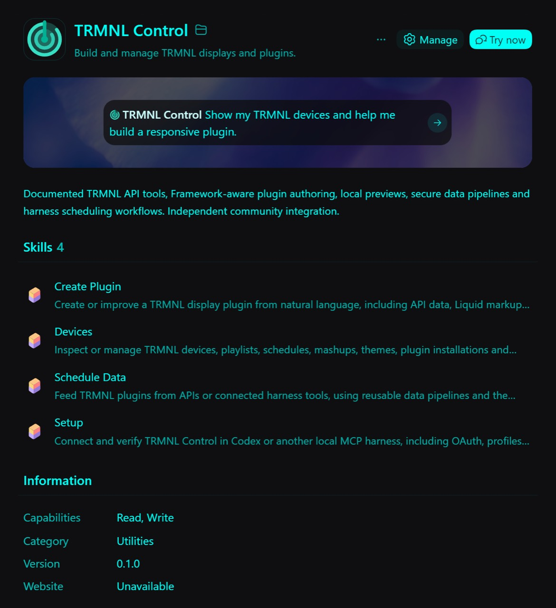

<p align="center"></p>

# TRMNL Controller

A local Codex plugin for building, managing and feeding TRMNL displays. Keep your markup in files, preview all four layouts, connect data sources and run repeatable updates from your own machine.

An independent community integration by [MarkHopper24](https://github.com/MarkHopper24), not an official TRMNL product. The TRMNL name and logo belong to TRMNL.

## Why use this instead of the hosted TRMNL MCP?

The [official TRMNL MCP](https://help.trmnl.com/en/articles/17432548-mcp-server) at `https://trmnl.com/mcp` is a good choice for connecting an agent directly to your account. It already supports devices, playlists, private plugin editing and related account operations. TRMNL also provides its own agent skills. If that's all you need, the hosted service has less to install and maintain.

TRMNL Controller is useful when the work needs to live on your machine:

| What you want | What this plugin adds |
| --- | --- |
| Develop a display like a small software project | Local markup and settings, validation, HTML previews, exports, and compare/deploy tools. Files can be reviewed and versioned in your own repository. |
| Turn an API response into a display | Saved JSON pipelines with host allowlists, environment-based secret references, field projection and payload checks. |
| Keep data fresh without an AI call every time | A deterministic worker with deduplication, retry backoff and publishing. Codex can help create the pipeline; Node runs subsequent updates. |
| Use information from your local tools | Author and run a local publisher or harness automation, with an explicit target and reviewed output. Private data stays local until your publisher sends it. |
| Use several accounts or a compatible BYOS server | Explicit profiles with separate server origins and credential references. Compatibility depends on that server's API. |

It still needs Node, your TRMNL authorization and a running machine for local jobs. It uses TRMNL's API and render allowances. The plugin doesn't make remote services available offline or add a scheduler to MCP.

## Screenshots

The supplied screenshots show the earlier **TRMNL Control** name and version. The current listing is **TRMNL Controller**.



<details>
<summary>Plugin listing and bundled skills</summary>



</details>

## Install in Codex in the ChatGPT desktop app

Requires Node.js **22.19 or later** on PATH, Git, and a desktop app version with local plugin marketplaces. This local stdio plugin runs on the computer; it cannot run in browser-only ChatGPT.

1. Clone this repository: `git clone https://github.com/MarkHopper24/trmnl-controller.git`.
2. Open the cloned folder as a project in Codex in the ChatGPT desktop app. Restart the app if necessary to discover its repository marketplace.
3. Open the Plugins directory, choose the **TRMNL Controller** marketplace/source, open **TRMNL Controller**, and install it.
4. Start a new chat, select the plugin and run its **Setup** workflow. Follow the authorization steps below.

If you have Codex CLI installed, you can instead register the GitHub marketplace with the commands below, then restart the desktop app and choose it in Plugins. The ready-made runtime is committed under `plugins/trmnl-controller`; installing it does **not** require `npm install` or a build.

## Install in Codex CLI

Use a current Codex CLI with `codex plugin` support. These commands are verified against Codex CLI 0.165.0:

```sh
codex plugin marketplace add MarkHopper24/trmnl-controller
codex plugin add trmnl-controller@trmnl-controller
codex plugin list --marketplace trmnl-controller --json
codex
```

Start a new session and invoke the plugin or its Setup skill. `/plugins` opens the interactive plugin browser in supported versions. **TRMNL Controller** is the display name; `trmnl-controller` is the identifier used in commands.

This is a GitHub marketplace install. A public GitHub repository is separate from acceptance into OpenAI's universal public plugin directory. See [distribution](docs/distribution.md) and the [official packaging guidance](https://developers.openai.com/plugins/build/plugins).

## Connect your own TRMNL account

Ask: “Set up TRMNL Controller and list my devices.” Setup checks `trmnl_status`, starts browser consent with `trmnl_auth_start`, and checks completion with `trmnl_auth_status`. Approve only the scopes and resources you want it to access. Default requested scopes are read, content and devices; delete, profile and apps are separate.

Then use `trmnl_list_devices` and `trmnl_list_models` as read-only checks. Installation and credential presence alone do not prove account access. If you prefer signing in from a terminal in the cloned repository:

```sh
node plugins/trmnl-controller/runtime/trmnl-control.mjs login
```

Leave that process running during consent. Credentials stay under `~/.trmnl-control`: Windows uses user-bound DPAPI; other systems use owner-only files. `TRMNL_HOME` overrides that location. Upgrades preserve it. Never paste a key into chat or commit one. See [setup](docs/setup.md) and [security and privacy](docs/security.md).

## Try it

> Show my devices and help me build a responsive private plugin. Preview all four layouts before adding it to a playlist.

> Create a pipeline for this JSON API. Dry-run its output, then help me schedule an update every 30 minutes.

> Check this plugin with long data, no data, stale data and portrait orientation.

The bundle includes four skills, 171 operations from the pinned official API specification, 28 helper tools, two resources and two prompts. See [coverage](docs/coverage.md), [Framework](docs/framework.md) and [validation](docs/validation.md). Counts describe available tools, not live execution of every endpoint.

## Scheduling and updates

`trmnl_schedule_plan` produces a plan. Your harness must create an actual automation, or you must run the deterministic worker under a scheduler/service you manage. Local jobs require the machine and relevant process to stay running. See [middleware](docs/middleware.md).

For a GitHub marketplace installation:

```sh
codex plugin marketplace upgrade trmnl-controller
codex plugin add trmnl-controller@trmnl-controller
```

For a cloned repository marketplace, run `git pull --ff-only` in that clone and reinstall/refresh the plugin. Restart the desktop app or begin a new CLI session after updates. Disable an older `trmnl-control@trmnl-control-local` install when migrating to avoid duplicate servers. Existing `TRMNL_*` settings, state storage and the `trmnl-control` command alias remain compatible.

## Development

```sh
npm ci --ignore-scripts
npm run bundle:plugin
npm test
npm run check
npm run smoke                 # public API reads only
npm pack                      # local candidate; does not publish to npm
```

Review regenerated `plugins/trmnl-controller` files alongside the source. The bundle includes dependency license notices; ZIPs and SHA-256 sidecars are generated under `dist/`. [Build and distribution details](docs/distribution.md).

MIT covers this implementation. Upstream specifications, dependencies and TRMNL branding retain their own terms. [Asset sources](plugin/assets/README.md).
